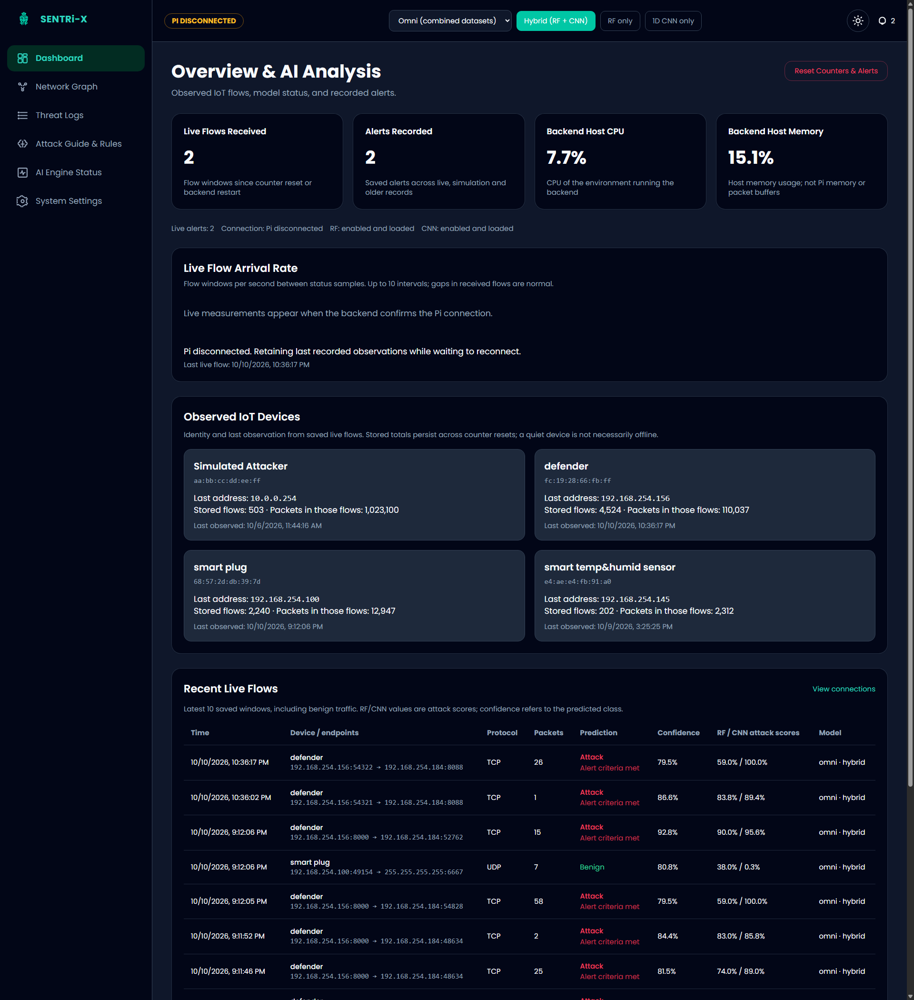
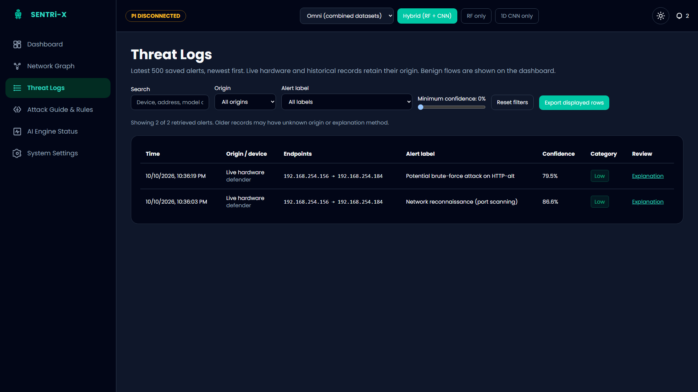
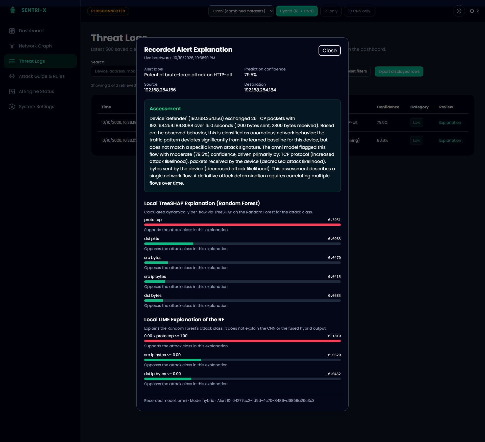
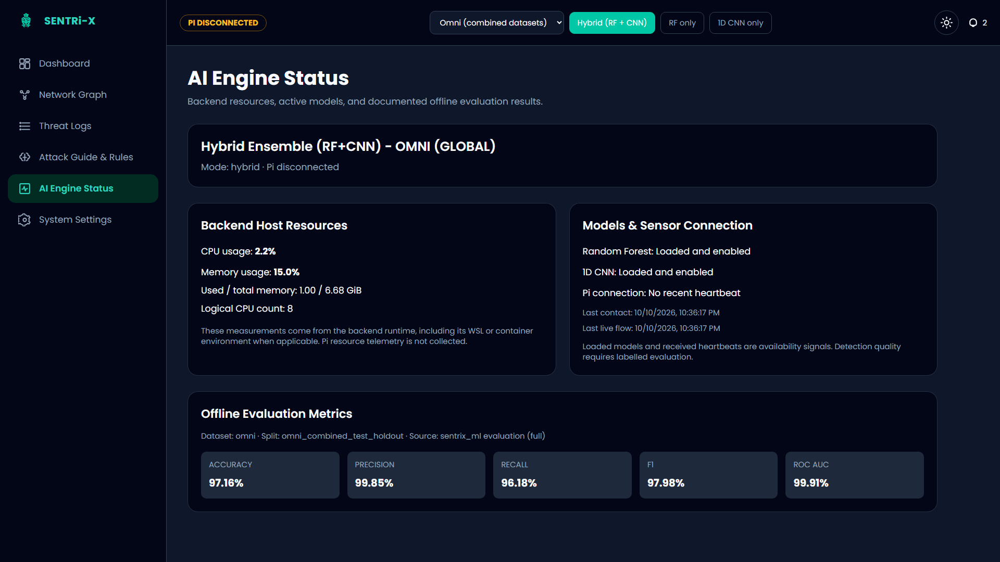
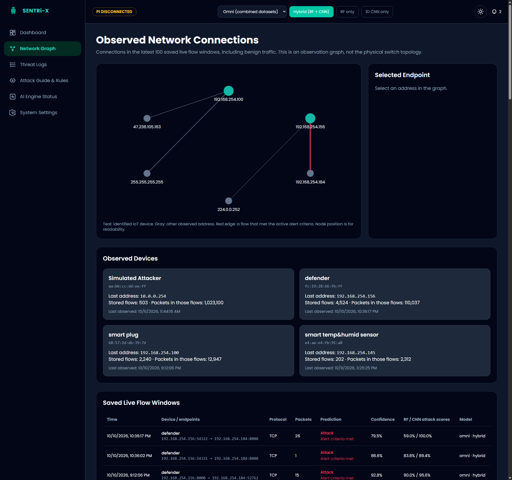

# SENTRi-X: Cross-Domain Hybrid Intrusion Detection System

SENTRi-X is an adaptive, Explainable AI (XAI)-powered Intrusion Detection System (IDS) for IoT and enterprise networks. It combines a **Hybrid Ensemble Engine**—fusing the tabular precision of **Random Forests (RF)** with the spatial pattern extraction of **1D Convolutional Neural Networks (1D CNN)**—with a real-time **Raspberry Pi Edge Sensor** and an interactive **React + FastAPI Monitoring Dashboard**.



---

## 🚀 Latest Updates & Key Capabilities

* **Omni Global & Domain-Specialist Defense Modes:** Hot-switch live between the unified **Omni Global** model (trained across ToN-IoT, BoT-IoT, and CIC-IDS2017) and domain-specific specialists (`ton_iot`, `bot_iot`, `cic_ids2017`) across **Hybrid (RF + CNN)**, **RF-only**, and **1D CNN-only** execution modes.
* **Transparent XAI with Surrogate Provenance Disclosure:**
  * Generates dynamic per-flow **TreeSHAP** values, **Local LIME** surrogate weights, and plain-English **RIPPER** security assessments.
  * Includes an explicit **Amber Provenance Disclosure** in `1D CNN-only` mode so operators know feature attributions are computed by the companion RF explainer rather than misattributed to the CNN.
* **Real-Time Inference Latency & Hardware Telemetry:**
  * Tracks and displays live per-flow inference latency (`last` and rolling `avg`, ~312 ms on CPU).
  * Reports honest hardware telemetry for both the **Backend Host** (CPU %, RAM GiB, explicit GPU/CUDA state) and the **Raspberry Pi Edge Sensor** (`sensor_cpu_usage` and `sensor_memory_usage` via live heartbeats).
* **Hardened Raspberry Pi Edge Sensor (`edge/sentrix_sensor.py`):**
  * Captures live network flows on `eth0` with IP-layer (`L3`) byte parity matching the `sentrix_ml` training distribution.
  * Dynamically syncs the monitored IoT device MAC allowlist from the dashboard (`/api/monitored-devices`) and filters out administrative SSH (`port 22`) and backend API (`port 8000`) traffic at both the BPF kernel filter and packet-processing layers.
* **Rich Threat Log Export (CSV, JSON, & PDF):**
  * Export filtered threat logs and malicious flow records complete with XAI narratives, TreeSHAP/LIME attributions, and model metadata in **CSV**, **JSON**, or formatted **PDF** reports.
* **Choreographed Live Demo & Scored Hardware TestKit (`attack_scripts/TestKit/`):**
  * Includes an automated, hands-free 3-Act live defense demonstration (`run_live_demo.py`) and a formal 6-trial scored evaluation suite (`run_scored_protocol.py`) with cryptographic manifest hashing and packet/flow audit logs.

---

## 🖼️ Dashboard & Explainable AI Previews

| Threat Logs & Filtering | Local TreeSHAP & LIME Explanation Modal |
| :---: | :---: |
|  |  |

| AI Engine Status & Hold-Out Benchmarks | Live Network Topology Graph |
| :---: | :---: |
|  |  |

---

## 📊 Verified Evaluation Metrics

### 1. Offline Hold-Out Benchmark (`sentrix_ml` Pipeline)
Evaluated on strictly held-out test splits using the canonical 28-feature schema:

| Dataset Domain | Mode | Accuracy | Precision | Recall | F1-Score | ROC-AUC |
| :--- | :--- | :---: | :---: | :---: | :---: | :---: |
| **Omni (Combined Hold-Out)** | Hybrid (RF + CNN) | **97.16%** | **99.85%** | **96.18%** | **97.98%** | **99.91%** |
| **ToN-IoT** | Hybrid (RF + CNN) | **99.80%** | **99.82%** | **99.78%** | **99.80%** | **99.98%** |
| **BoT-IoT** | Hybrid (RF + CNN) | **99.80%** | **99.85%** | **99.70%** | **99.70%** | **99.95%** |
| **CIC-IDS2017** | Hybrid (RF + CNN) | **98.14%** | **98.40%** | **97.90%** | **98.15%** | **99.72%** |

### 2. Live Physical Testbed Demonstration (`SCORED-*` Protocol)
Executed on the physical hardware testbed (Laptop Attacker/Backend + Raspberry Pi 3B+ Edge Sensor & Target Node):
* **Attack Recall (S1 TCP Port Scan & S2 HTTP Credential Probing):** **100% (4 / 4 attack trials detected in-window)** with a mean time-to-first-detection of **3.5 seconds** (sub-second `0.06s–0.07s` on warm flows).
* See [HOW_TO_RUN_DEMO.md](HOW_TO_RUN_DEMO.md) and [SCORED_DEMO_PROTOCOL.md](attack_scripts/TestKit/SCORED_DEMO_PROTOCOL.md) for the complete trial table and audit notes.

---

## 💻 Quick Start: Running the Live Hardware Demo

For the complete step-by-step hardware guide and panel talking points, see **[HOW_TO_RUN_DEMO.md](HOW_TO_RUN_DEMO.md)**.

### Step 1: Start the FastAPI Backend (WSL2 Ubuntu)
```bash
cd /mnt/c/Users/LENOVO/SENTRi-X
bash backend/start_backend.sh
```
Verify backend health from PowerShell:
```powershell
curl.exe http://127.0.0.1:8000/api/status
```

### Step 2: Start the React Frontend Dashboard (Windows PowerShell)
```powershell
cd C:\Users\LENOVO\SENTRi-X\frontend
npm run dev
```
Open **[http://localhost:5173](http://localhost:5173)** in your browser.

### Step 3: Start the Edge Sensor on the Raspberry Pi
SSH into the Raspberry Pi (`ssh raspy3@192.168.254.184`) and run:
```bash
sudo python ~/sentrix_sensor.py
```
*(Optional: To run an open HTTP listener on port `8088` on the Pi for S2 HTTP probes, run `python3 -m http.server 8088 --bind 192.168.254.184` in another Pi terminal).*

### Step 4: Run the Choreographed Live Attack Demonstration (Windows PowerShell)
Run the automated 3-Act demonstration covering all datasets (`omni`, `ton_iot`, `bot_iot`), engine modes (`hybrid`, `cnn`), real-time latency, and XAI provenance:
```powershell
cd C:\Users\LENOVO\SENTRi-X\attack_scripts\TestKit
python run_live_demo.py
```
*(Pass `--manual` if you prefer to pause and press Enter between acts).*

---

## 📂 Repository Structure

```text
SENTRi-X/
├── backend/                  # FastAPI inference engine, TreeSHAP/LIME XAI, PDF/CSV/JSON export
├── frontend/                 # React + Vite real-time threat monitoring dashboard
├── edge/                     # Raspberry Pi Scapy flow sensor (sentrix_sensor.py)
├── sentrix_ml/               # Canonical 28-feature training, scaling & evaluation pipeline
├── models/                   # Trained RF (.joblib), 1D CNN (.keras/.h5) & StandardScaler artifacts
├── attack_scripts/TestKit/   # Controlled lab evaluation kit, 3-Act live demo & scored protocol
├── screenshots/              # Dashboard UI screenshots
└── HOW_TO_RUN_DEMO.md        # Complete live hardware testbed guide & defense talking points
```

---

## 🛠️ Installation & Environment Setup

1. **Clone the repository:**
   ```bash
   git clone https://github.com/JethroIsHere/SENTRi-X.git
   cd SENTRi-X
   ```

2. **Backend Python Environment (WSL2 / Linux or Windows):**
   ```bash
   python3 -m venv wsl_venv
   source wsl_venv/bin/activate
   pip install -r requirements.txt
   ```

3. **Frontend Dependencies:**
   ```powershell
   cd frontend
   npm install
   npm run dev
   ```
